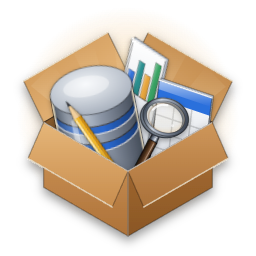
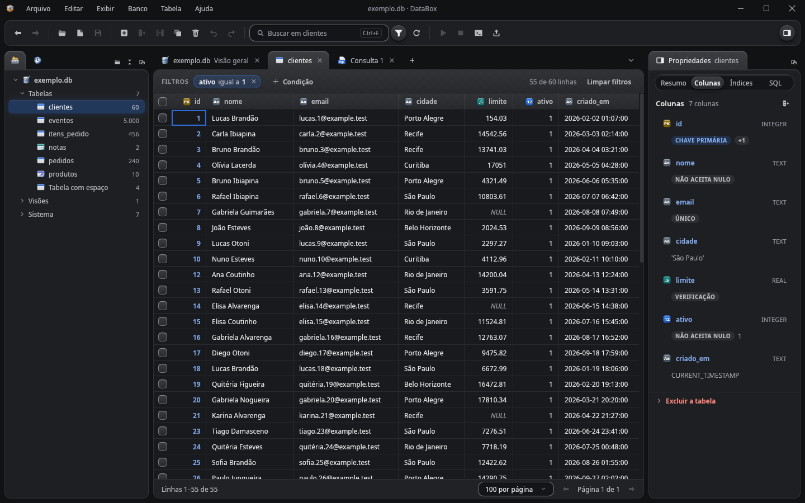
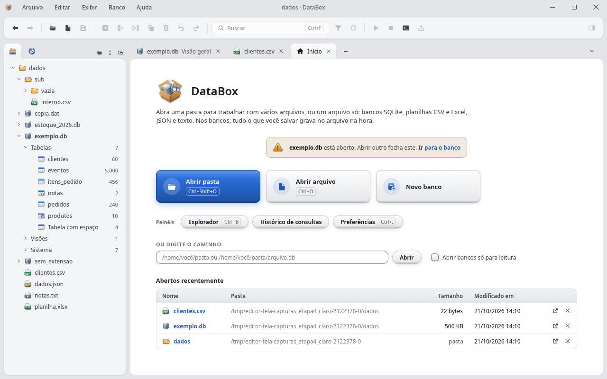
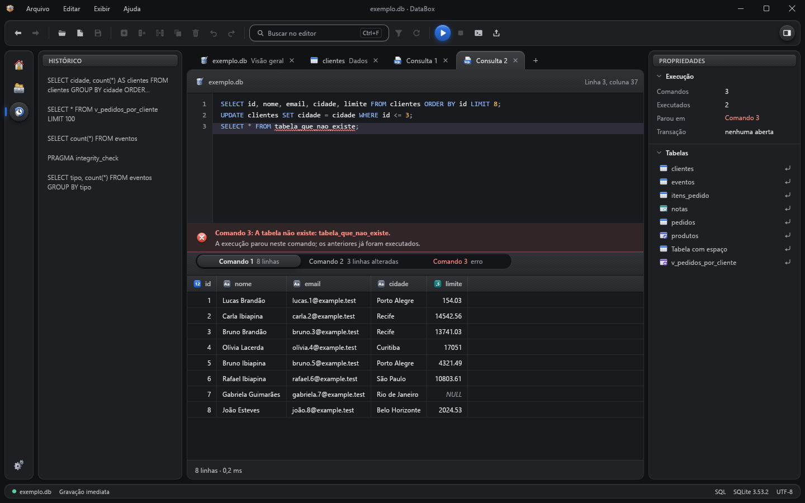
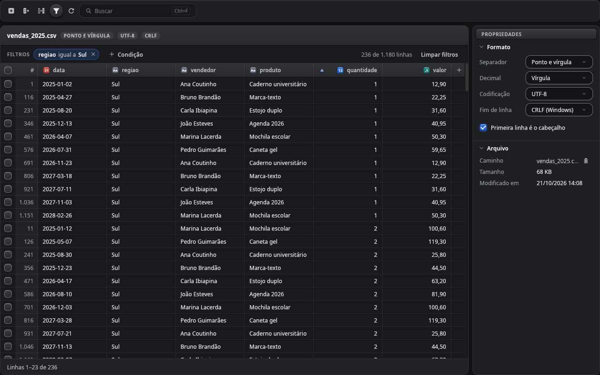
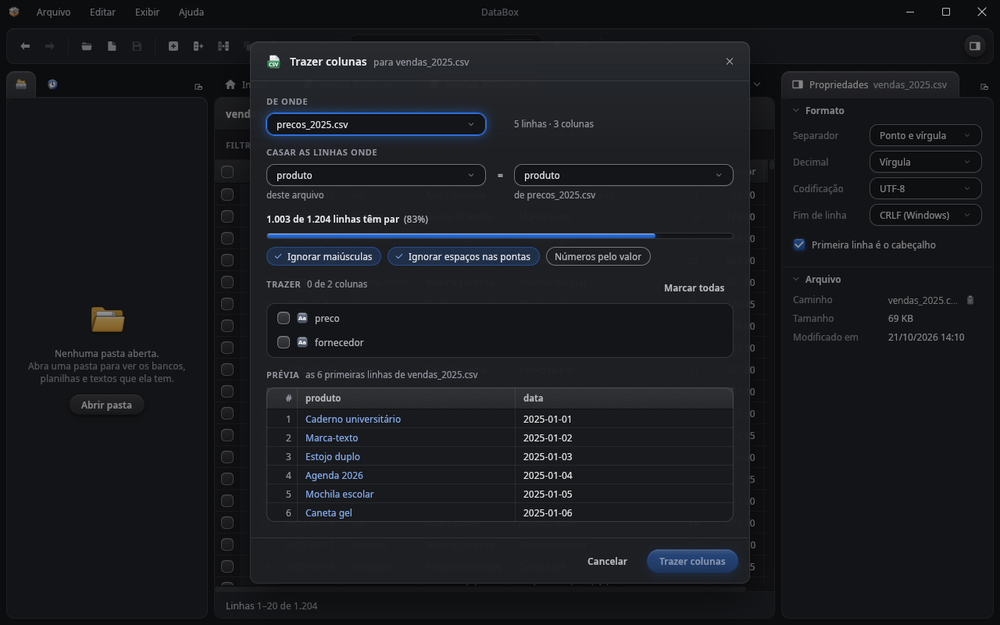
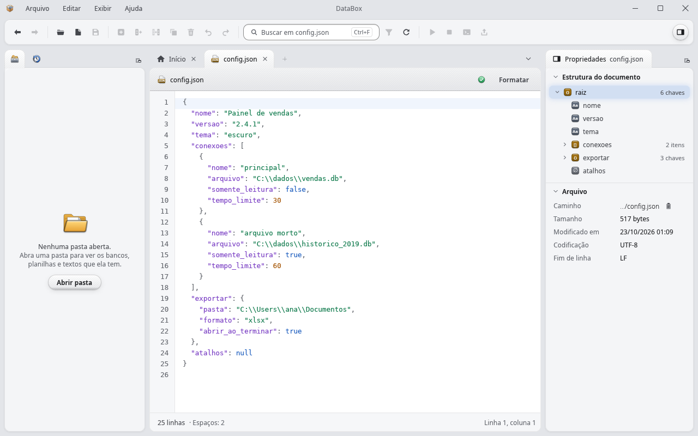
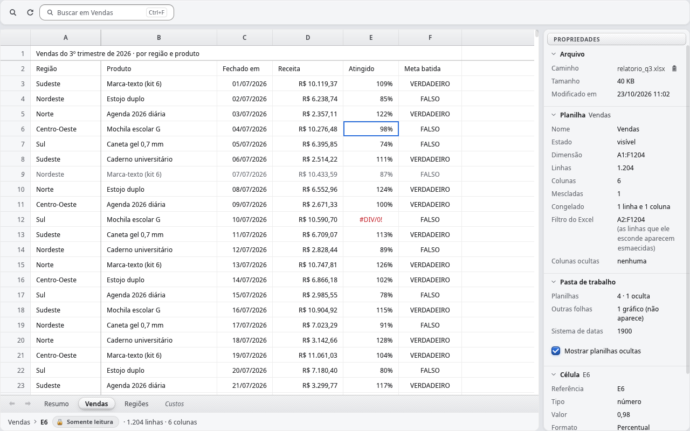

<p align="center">
  
</p>

<h1 align="center">DataBox</h1>

<p align="center">
  <strong>Open, explore, clean and export your data from a single <code>.exe</code>.</strong><br>
  SQLite, CSV, JSON, Excel and whole folders. Nothing to install, no server, nothing sent to the cloud.
</p>

<p align="center">
  <a href="LICENSE"></a>
  <a href="../../releases/latest"></a>
  <a href="../../actions/workflows/ci.yml"></a>
  
  
</p>

<p align="center">
  <strong>English</strong> · <a href="README.pt-BR.md">Português</a>
</p>

<p align="center">
  <a href="../../releases/latest"><strong>⬇ Download DataBox.exe</strong></a> ·
  <a href="#quick-guides">Quick guides</a> ·
  <a href="#features">Features</a> ·
  <a href="#roadmap">Roadmap</a>
</p>

<p align="center">
  
</p>

**DataBox** is a free, open-source data toolbox for data scientists, data engineers and developers. It is a Windows
desktop app (with a Linux AppImage) that opens, shows and edits everyday data files: **SQLite** databases, whole folders
with their data files, **CSV**, **JSON** and text files, and **Excel workbooks** (read-only). The UI is drawn straight
on the GPU with [egui](https://github.com/emilk/egui), in Rust. Current version: **0.2.2**.

> The interface, the code and the in-depth docs are in **Brazilian Portuguese** for now (the full guide is
> [README.pt-BR.md](README.pt-BR.md)). An English UI is on the roadmap; contributions are welcome.

---

## Why DataBox

- 📦 **One `.exe`, no installer.** No runtime, no browser, no server, no Java or Python. Download, double-click,
  done; it even runs from a USB stick.
- 🔒 **Local and private.** Your data never leaves your machine: no account, no cloud, no telemetry.
- ⚡ **Fast on big files.** A one-million-row CSV opens instantly (the grid reads pages, never the whole file); a large
  workbook shows its first page right away; one million rows export to Excel in about 7 s.
- 🛡️ **Safe with your data.** Every structure change shows the SQL it will run first; databases can open read-only;
  CSV saves keep the file's format and leave unchanged lines alone, and never overwrite a file another program changed.
- 🧰 **A toolbox, not just an editor.** Open a folder and work with its databases, CSV, workbooks and JSON side by side
  in tabs, and join one file with another.
- 🎨 **Pleasant to use.** Light and dark themes, frosted glass, its own icon set, panels you can arrange your way
  and keyboard shortcuts for everything.

---

## Gallery

<table>
  <tr>
    <td width="50%" valign="top"><a href="docs/imagens/inicio-pasta-claro.png"></a><br><sub><b>Home</b> with a folder open: databases, CSV, JSON, text and workbooks in the Explorer, and the panel shortcuts</sub></td>
    <td width="50%" valign="top"><a href="docs/imagens/consulta-sql-escuro.png"></a><br><sub><b>SQL Query</b> with several statements: a result for each, the error shows where it stopped, and the History alongside</sub></td>
  </tr>
  <tr>
    <td width="50%" valign="top"><a href="docs/imagens/csv-filtro-escuro.png"></a><br><sub>A 1,180-row <b>CSV</b> filtered by region and sorted by quantity</sub></td>
    <td width="50%" valign="top"><a href="docs/imagens/csv-trazer-colunas-escuro.png"></a><br><sub><b>Bring columns</b>: join two files on a common column, with preview</sub></td>
  </tr>
  <tr>
    <td width="50%" valign="top"><a href="docs/imagens/json-estrutura-claro.png"></a><br><sub><b>JSON</b> validated, with colors, a Format button and the document outline</sub></td>
    <td width="50%" valign="top"><a href="docs/imagens/excel-planilha-claro.png"></a><br><sub><b>Excel</b> (read-only): sheet tabs, frozen panes, filter and cell details</sub></td>
  </tr>
</table>

---

## Download

Grab `DataBox.exe` from the latest [release](../../releases/latest) and double-click it. Nothing to install. Requires
Windows 10 or 11, 64-bit.

> The executable is not code-signed, so Windows SmartScreen may warn you the first time ("Windows protected your
> PC"). Click **More info › Run anyway**, or build it yourself (below).

**Linux (experimental):** grab `DataBox-…-x86_64.AppImage`, make it executable and run it (double-click, or
`chmod +x DataBox-*.AppImage && ./DataBox-*.AppImage`). Nothing to install; `--criar-atalho` adds it to the
applications menu, pointing at the AppImage. Without FUSE, run it with `--appimage-extract-and-run`.

| Type | Extensions | How it opens |
|---|---|---|
| SQLite database | `.db`, `.sqlite` (and any file that is SQLite inside) | full editing, or read-only on request |
| Folder | any folder | the Explorer lists its databases and data files |
| CSV | `.csv`, `.tsv` | table editor |
| JSON and text | `.json`, `.txt`, `.md`, `.log` | text editor (read-only above 0.5 MiB) |
| Excel workbook | `.xlsx`, `.xlsm` | read-only |

---

## Quick guides

The labels below are translated; the app shows them in Portuguese (the main ones are given in parentheses).

### Explore a SQLite database

1. **File › Open folder** (Ctrl+Shift+O) and pick the database's folder, or drag the `.db` onto the window. To look
   without risk, tick **Open databases read-only** on the Home screen.
2. The **Overview** shows how many tables, views, indexes and triggers the database has. Click a table in the Explorer.
3. The table's tab shows its data: use search, **filters** and the header arrow to sort. Double-click a cell to edit
   it; it is saved right away, and the notice says where and offers **Undo** (or Ctrl+Z). The row form shows BLOB,
   NULL and generated columns.
4. Drag from one cell to another (or Shift with the arrows) to **select a range**; Ctrl+C copies it like Excel does,
   ready to paste into a spreadsheet. **Right-click** it (or Shift+F10) for the selection menu: copy with the header
   (Ctrl+Shift+C) or as CSV, JSON, Markdown, `INSERT`, an `IN (…)` list or pandas, filter by the cell's value, mark
   the rows and open the row form. With more than one cell, the footer shows the count, sum, average, min and max.
5. **Properties** shows how the table is built: **Summary**, **Columns**, **Indexes** and **SQL** (Alt+1 to Alt+4);
   the chosen column lights up in the grid. Altering a column or creating an index always shows the SQL that will run
   first.

### Clean a CSV and join it with a spreadsheet

1. Open the CSV (Ctrl+O). The whole file shows up at once, with each column's detected type in the header.
2. **Filter** rows with conditions and **sort** by the header arrow. Fix cells with double-click, F2 or Enter; delete
   rows and columns; Ctrl+Z undoes.
3. Open the Excel workbook too. Right-click its column header and choose **Bring columns from this sheet** (*Trazer
   colunas desta planilha*), or use **Bring columns** (*Trazer colunas*) in the CSV, which also accepts another CSV,
   the clipboard or a file on disk.
4. Pick the common key and the columns to bring, check the **preview** and confirm. It is a single change: one Ctrl+Z
   undoes all of it.
5. **Save** (Ctrl+S) writes the file in its original format (encoding, delimiter, line endings).

### Export a query to Excel

1. With a database open, open a **SQL Query** (*Consulta SQL*) and write your `SELECT`. The code is colored and the
   query goes to the **History**.
2. Run it; if it takes too long, **Stop** (*Interromper*, Esc) halts it.
3. Click **Export** (*Exportar*) and choose **Excel** (or CSV, or JSON). A progress bar follows along; one million rows
   take about 7 s.
4. You can also export a whole table, only what search and filters show, the marked rows or the whole database.

### Validate and format a JSON file

1. Open the `.json` (Ctrl+O, or click it in the folder Explorer).
2. The **valid** or **error** sign shows right away; on an error it tells the line, column and reason, and a click
   jumps there.
3. **Format** (*Formatar*) fixes indentation without changing key order or numbers.
4. The document **outline** shows in Properties (Ctrl+Alt+B shows or hides the panel).

---

## Features

**Everywhere**
- Document tabs with a single **Back/Forward** history across tabs (Alt+←/→ or the mouse side buttons); drag a tab
  to reorder it (or Ctrl+Shift+PageUp/PageDown), and "All tabs" lists them.
- Custom window on Windows and Linux: title bar with the File, Edit, View, Database, Table and Help menus, one
  toolbar for every tab, Explorer and query History docked on the left, Properties on the right; optional status bar
  (View › Status bar).
- **Docked panels:** drag a panel's tab to the other dock, or out of the window to open it in a window of its own
  (or use *Destacar em janela*, "Pop out"). Each panel's place and width are remembered.
- **Select a range of cells** in Data, CSV, Excel and SQL results: drag, Shift+click or Shift with the arrows;
  Ctrl+C copies it tab-separated, ready for a spreadsheet.
- **Right-click the selection** (or Shift+F10): copy with the header or as CSV, JSON, Markdown, `INSERT`, an `IN (…)`
  list or pandas; filter by that value or leave it out; mark the rows; open the row form. The footer sums the
  selection like Excel's status bar (count, sum, average, min and max).
- Frosted glass on menus, lists and dialogs; Light, Dark or Follow Windows theme.
- Preferences (Ctrl+,): theme, code colors and font, export options; changes preview live and persist on **Save**.
- **Search** (Ctrl+F) in every document, CSV, Excel and text included: the whole file, ignoring case and accents;
  Enter and Shift+Enter go to the next and previous match, the strip shows "3 de 41" ("3 of 41"), Esc goes back.
- Drag and drop a folder, database or data file onto the window to open it.
- Asks before closing a tab, folder or the app with unsaved changes.

**Folders**
- File › Open folder (Ctrl+Shift+O). The Explorer shows subfolders, databases (detected by content, not by
  extension), CSV, workbooks, JSON and text files; hidden files, Office lock files and tool folders (`.git`,
  `node_modules`…) are skipped. Right-click for Open, Refresh, Show in folder, Copy path, Close folder.

**SQLite**
- Database overview with counters of tables, views, indexes and triggers.
- **Data** grid with search, filters, sorting, in-place editing (the last edit can be undone), marked rows, a row
  form (BLOB, NULL, generated columns), New row, Duplicate and Delete.
- **Columns**, **Indexes and triggers** and **SQL** for each table in Properties; New table, New column, New index
  and Alter column, always showing the SQL that will run before it runs.
- **Database** menu (maintenance, backup copy, export, close) and **Table** menu (views, Open in SQL Query, Copy
  name, Rename, Delete).
- **SQL Query**: as many queries as you like at once, syntax colors, query History and **Stop** (Esc).
- **Export** to Excel, CSV or JSON (a table, only what search and filters show, marked rows, a query result or the
  whole database), with progress. 1 million rows to Excel in about 7 s.
- Open databases **read-only** to look without risk.

**CSV**
- Opens files with millions of rows instantly (paged, never fully loaded), with the detected type of each column.
- Edit cells, add/duplicate/delete rows and columns, undo/redo, filter with conditions and sort by column.
- Search (Ctrl+F) the whole file, unsaved edits included and only in the rows the filter shows.
- Copy and paste columns, paste matching by key (Ctrl+Shift+V), and **Bring columns** from another file (CSV,
  Excel sheet, clipboard) by a common key, with preview and a single undo step.
- **Save** keeps the file's encoding, delimiter and line endings and does not touch unchanged lines.

**JSON and text**
- Line numbers; for JSON, syntax colors, valid/invalid indicator with line, column and reason, **Format** (keeps key
  order and numbers) and a document outline.
- Editable up to 0.5 MiB; larger files open read-only up to 32 MiB. Encoding and line endings round-trip.
- Search (Ctrl+F) the whole text, read-only files included; the match is highlighted.

**Excel**
- Read-only, with sheet tabs (including hidden sheets on request), column widths, merged cells and frozen panes.
- Large sheets show the first page immediately and keep indexing in the background.
- Copy a cell or a column, or bring a sheet's columns into the open CSV.
- Search (Ctrl+F) the whole sheet, as the grid shows it (hidden columns are skipped).

The full feature list, keyboard shortcuts and details are in the [Portuguese guide](README.pt-BR.md#recursos).

---

## Command line

```text
DataBox.exe [path] [--somente-leitura] [--moldura-do-sistema] [--renderizador glow|wgpu] [--criar-atalho] [-h | --ajuda] [--versao]
```

- `DataBox.exe C:\data` opens the folder; add `--somente-leitura` to open a database read-only.
- `--criar-atalho` creates Desktop and Start menu shortcuts and exits.
- `--moldura-do-sistema` uses the system title bar and borders instead of DataBox's own (on Linux, for a window manager
  where the undecorated window misbehaves).
- Settings live in `%APPDATA%\DataBox\preferencias.json`; the log is `%LOCALAPPDATA%\DataBox\databox.log`.

---

## Roadmap

DataBox aims to be a data toolbox, not only a SQLite editor. What's coming, roughly in this order (suggestions welcome
in [issues](../../issues)):

| | Improvement | What it means for you |
|---|---|---|
| 📊 | **Column profiling** | Nulls, distinct values, mean, most frequent values and a histogram for each column: "what's in here" at a glance. |
| 🧾 | **More formats** | JSON Lines (`.jsonl`, `.ndjson`) as a table, `.sql` scripts opened in the SQL Query, and large logs (above 32 MiB) with search. |
| 🔁 | **Format conversion** (Save as) | CSV to Excel or SQLite and back, with the right types; plus **Save all**. |
| ✏️ | **Large text** | Edit text above 0.5 MiB. |
| 🧮 | **SQL over CSV** | Run `SELECT … GROUP BY` straight on a CSV or a spreadsheet. |
| 📈 | **Charts** | Bars, lines, histograms and scatter plots drawn by DataBox itself from a table, query or CSV; and **Open in Python**, which writes the Seaborn/Matplotlib script and runs it with the Python you already have. |
| 🗄️ | **More databases** | A single data-source contract, starting with **PostgreSQL** (read-only by default); then **MySQL/MariaDB**, **SQL Server** (via ODBC) and, as an optional build, **DuckDB and Parquet**. Passwords stay in the system's credential store. |

Also queued: a database table as the target of Bring columns; Excel's `.xls` and `.xlsb` formats; an English UI; macOS.
Linux already ships as an AppImage (experimental, see [Download](#download)); reports from real desktops are welcome.

---

## Building from source

**Tools** (once, no admin rights needed):

- **Rust** stable via [rustup](https://rustup.rs), with the **GNU** toolchain (no Visual Studio required; the MSVC
  toolchain is not supported yet):

  ```powershell
  rustup-init.exe --default-host x86_64-pc-windows-gnu --profile minimal -c clippy -c rustfmt
  ```

- **MinGW-w64 from [WinLibs](https://winlibs.com)** (GCC 16, MSVCRT, without LLVM), extracted to
  `%LOCALAPPDATA%\Programs\winlibs-gcc16` (the `mingw64` folder goes inside it), or anywhere else with the
  `DATABOX_MINGW` environment variable pointing to its `bin` folder.

**Always build through `cargo.ps1`**, a drop-in for `cargo` with the same arguments (quote `--` as `'--'`, or
PowerShell swallows it). It puts Rust and MinGW on the
PATH and wires a small linker shim ([`ferramentas/vincular.rs`](ferramentas/vincular.rs)) that rewrites accented paths
to their 8.3 short names; without it, MinGW's `ld` fails in user folders with accents.

```powershell
.\cargo.ps1 run -p amostras '--' exemplo.db       # create a sample database
.\cargo.ps1 run -p editor '--' exemplo.db         # open DataBox with it
.\cargo.ps1 build --release -p editor           # optimized build in target\release\DataBox.exe
.\cargo.ps1 test --workspace                    # all tests
.\cargo.ps1 clippy --workspace --all-targets '--' -D warnings
.\cargo.ps1 fmt --all '--' --check
```

Or double-click [`compilar.bat`](compilar.bat), which builds the release binary and copies it to `dist\DataBox.exe`.
Keep the project in a shallow folder: paths over 260 characters break the Windows build.

**Linux (experimental):** plain `cargo`, no `cargo.ps1`. On Debian/Ubuntu, install the build packages once:

```bash
sudo apt-get install libxkbcommon-dev libwayland-dev libx11-dev libxcursor-dev libxrandr-dev libxi-dev libgl1-mesa-dev
cargo build --release -p editor        # target/release/DataBox
./target/release/DataBox --criar-atalho  # adds DataBox to the applications menu (~/.local/share/applications)
ferramentas/appimage.sh                  # builds dist/DataBox-<version>-x86_64.AppImage (needs curl)
```

At run time it uses the desktop's file dialogs (`xdg-desktop-portal`), `xdg-open` (package `xdg-utils`) and the Noto
Sans or DejaVu fonts. The window has DataBox's own title bar, as on Windows (`--moldura-do-sistema` switches back to
the system one), and follows GNOME's text size. The Linux build is checked by CI and has been tried on GNOME; reports
from other desktops are welcome.

The screenshots in this README ([`docs/imagens/`](docs/imagens)) come from the screen tests, which render each screen
headlessly with `egui_kittest` and save PNGs to `capturas\rust\`. On Windows, run them on one thread, as CI does
(`.\cargo.ps1 test -p editor -p interface -p 'tela_*' '--' --test-threads=1`): in parallel, the Windows software
renderer (WARP) crashes with `STATUS_ACCESS_VIOLATION`. On Linux everything runs in parallel, and its screenshots are
the reference. A test that fails twice because of the environment gets `#[ignore]` and an issue, never a retry.

More: [`README.pt-BR.md`](README.pt-BR.md) (full guide), [`ARQUITETURA.md`](ARQUITETURA.md) (architecture and crate
contracts), [`design/README.md`](design/README.md) (visual guide), [`RELEASE.md`](RELEASE.md) (how to publish a
release).

---

## Contributing

See [`CONTRIBUTING.md`](CONTRIBUTING.md). Ideas and bugs go to [issues](../../issues); if DataBox helped you, a ⭐ on
the repository helps other people find it.

## License

[MIT](LICENSE). The UI uses the fonts that ship with Windows (Segoe UI and Consolas) and DataBox's own logo. Direct
dependencies are MIT and/or Apache-2.0; transitive ones include other permissive licenses (Unicode-3.0, BSL-1.0, Zlib,
ISC, MPL-2.0), and the executable embeds egui's default fallback fonts (SIL OFL 1.1 and Ubuntu Font Licence). The list
of libraries with each license is inside the app (Help › About › Third-party licenses) and, with the license texts, in
the `THIRD-PARTY-NOTICES.txt` of each release `.zip`.
